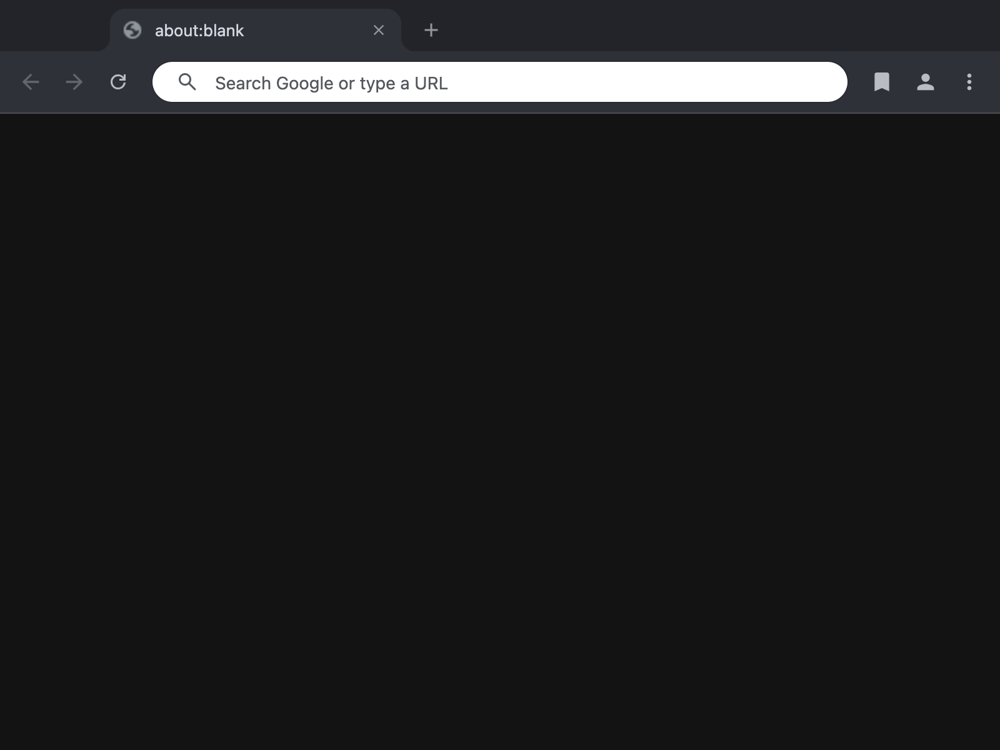
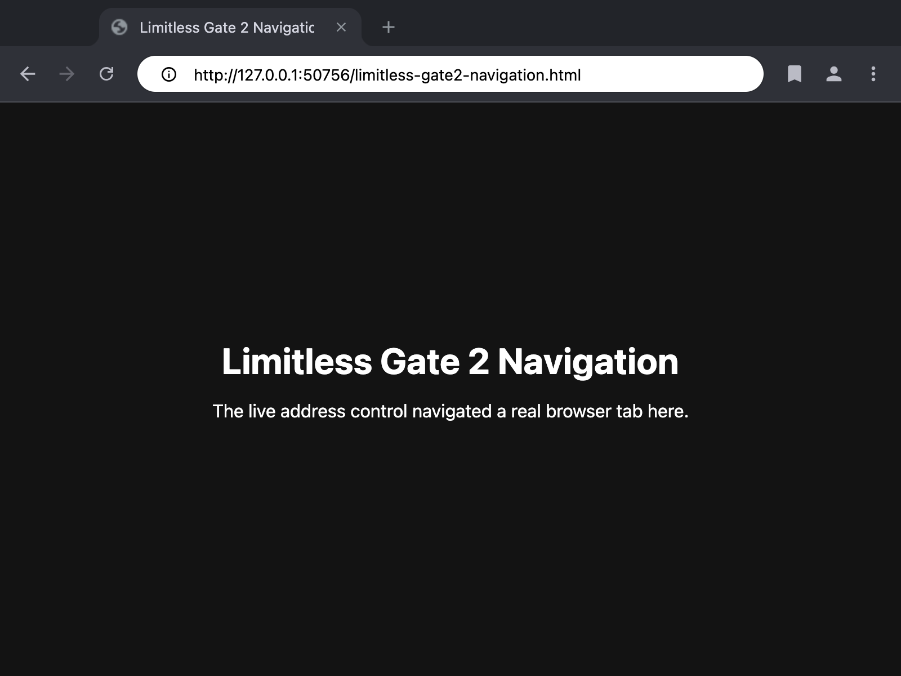

# Gate 2 rejected shell baseline

Status: **Product UI hard red**

These images preserve the disposable Chromium WebUI Browser shell used to test
the Gate 2 integration seam. They are behavioral evidence only. They are not a
visual acceptance baseline, a proposed Limitless design, or progress toward the
product shell required by `docs/features.md`.

The captures contain the renderer surface only. They do not include the native
macOS titlebar, traffic lights, window shadow, or desktop placement.

## Rejected visual reference

Before navigation:

After navigation:

## Observed product gaps

- Oversized rounded horizontal Chrome tabs replace the required compact
  vertical tabs and workspace rail.
- The address field is a large pill rather than a sharp, compact browser
  control.
- Bulky retained toolbar controls consume too much space and preserve Chrome's
  visual hierarchy.
- The active tab title clips instead of degrading cleanly.
- There is no vertical workspace and browser-agent rail.
- There is no visible agent state, compact split affordance, or Arc-style
  information density.
- The shell does not express the gradient themes or sharp Limitless visual
  identity requested for v1.

## Decision boundary

Do not polish this shell unless a defect blocks integration-seam evidence. The
SwiftUI/WebUI boundary comparison must select the production shell first. The
first product UI checkpoint after that decision must replace these surfaces
with the compact vertical design required by `docs/features.md` and must receive
a fresh pixel-level review.

Behavioral claims, including address navigation, tab identity, SurfaceEmbed
state, and clean shutdown, must be reported and tested separately from product
UI approval.

## Retained incomplete-call evidence

The passing tab-state browser proof still logs upstream `NOTIMPLEMENTED` calls.
They are architecture evidence, not harmless test noise:

| Observed call | Classification | Current evidence and production consequence |
| --- | --- | --- |
| `LinkOpeningFromGesture`, `UpdateLoadingAnimations`, `GetStatusBubbles`, `UpdateToolbar` | Navigation | The tested browser-process navigation and reload path still works, but link disposition, loading feedback, status presentation, and toolbar synchronization are incomplete. |
| `WebUIStubLocationBar::GetOmniboxController`, `Revert` | Navigation and focus | The proof does not use the stub as navigation authority. A production address surface cannot depend on null controller access or missing focus-state restoration. |
| `UpdateToolbarSecurityState`, `WebUIStubLocationBar::UpdateContentSettingsIcons` | Security state | These are production blockers. A shell must not present stale or absent connection identity, permission, or content-setting state even when page navigation itself succeeds. |
| `WebUIStubLocationBar::SaveStateToContents`, `OnTabDetached`, `GetRestoredState` | Lifecycle | Two-tab switch and close state pass through supported browser routes, but address-state persistence, detach behavior, and restored native-window state remain incomplete. |
| `GetWorkspace`, `IsVisibleOnAllWorkspaces` | Native lifecycle | They did not block the focused test, but macOS workspace visibility and restoration remain unproved. |
| `SurfaceEmbedWebPlugin::DidFinishLoading` | Rendering lifecycle | The tested surface reached the required state despite this call, but load completion is not a production-ready lifecycle contract. |

These calls keep the WebUI candidate conditional. In particular, the security
state methods cannot be deferred as cosmetic work, and the lifecycle methods
must pass session restore, detach, and workspace journeys before selection.
